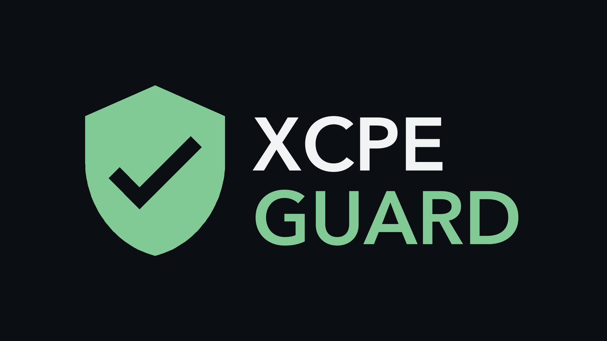
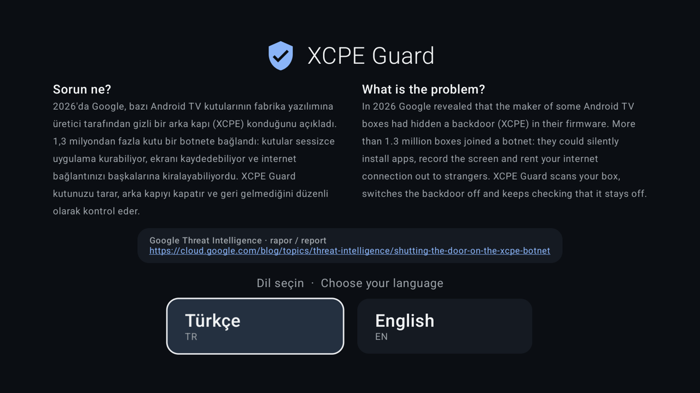
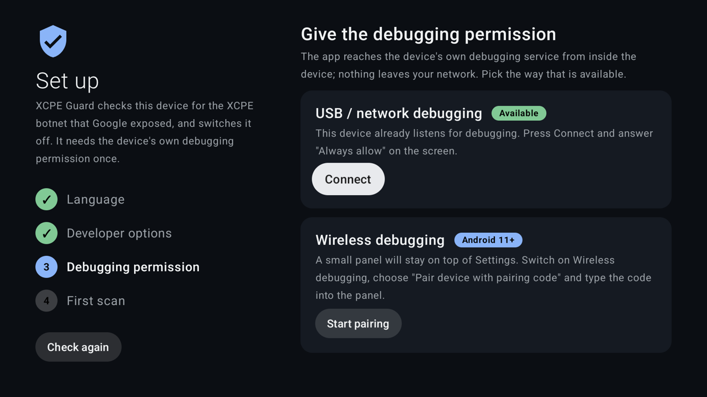
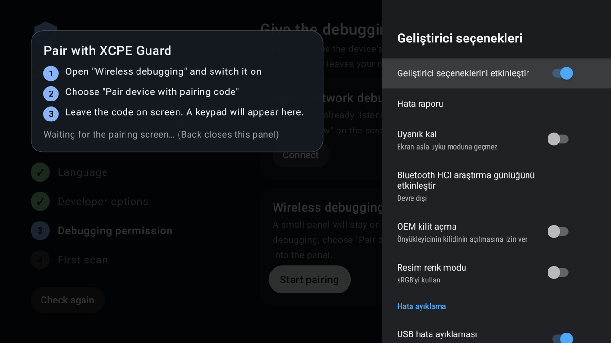
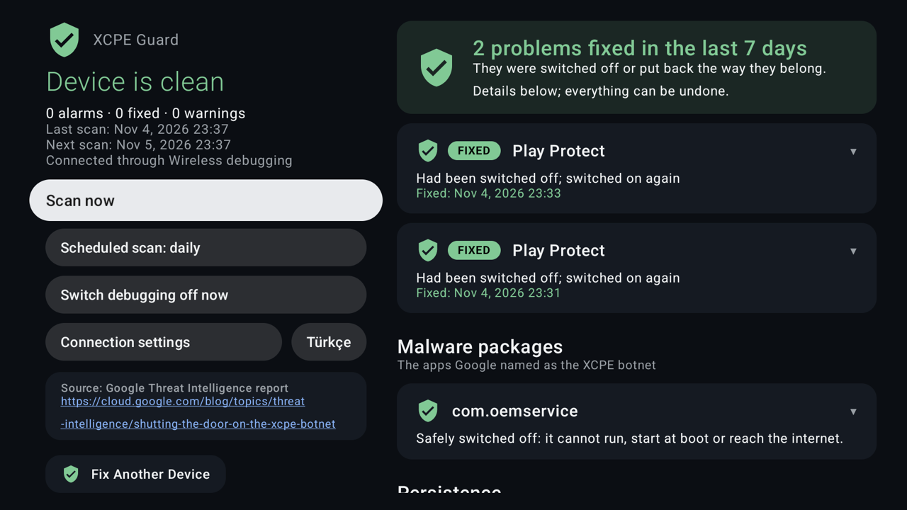
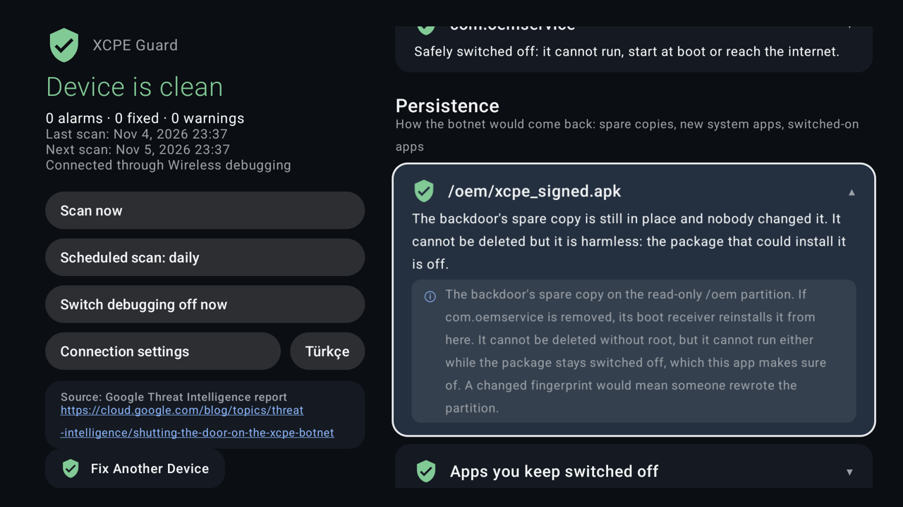
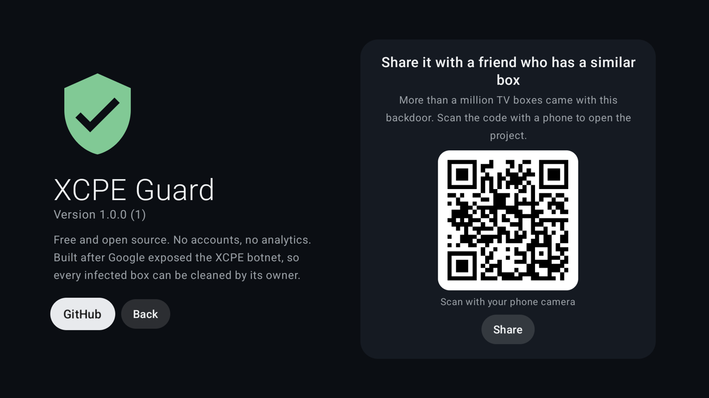

<p align="center">
  
</p>

<h1 align="center">XCPE Guard</h1>

<p align="center">
  <b>Find and switch off the XCPE botnet on Android TV boxes, from the box itself. No computer, no root.</b>
</p>

<p align="center">
  <a href="https://github.com/burakztrk/xcpe-guard/releases/latest"></a>
  <a href="https://github.com/burakztrk/xcpe-guard/actions/workflows/release.yml"></a>
  
  <a href="LICENSE"></a>
</p>

<p align="center">
  <a href="https://github.com/burakztrk/xcpe-guard/releases/latest/download/xcpe-guard.apk"><b>⬇ Download the latest APK</b></a>
  · <a href="README.tr.md">Türkçe</a>
</p>

---

In 2026 Google Threat Intelligence published
[Shutting the door on the XCPE botnet](https://cloud.google.com/blog/topics/threat-intelligence/shutting-the-door-on-the-xcpe-botnet).
The maker of many Android TV set-top boxes had placed a backdoor (`x.cpe` / `com.oemservice`) in their firmware. It runs
with system rights, silently installs apps, runs commands, records the screen, presses keys and rents your connection
out as a proxy. More than **1.3 million** boxes joined the botnet.

Google took the servers down, but the backdoor is still in the firmware of every one of those boxes. XCPE Guard checks a
box against the indicators in that report, switches the backdoor off, and checks again every day.

## Screenshots

| Choose a language | Give the permission once |
|---|---|
|  |  |
| **Pair with a code, on top of Settings** | **Problems fixed automatically** |
|  |  |
| **Every item explains itself** | **Share with a friend** |
|  |  |

## How it works

Android lets an app talk to the device's own debugging service (adbd) once the owner allows it. The botnet abused that
same service; here it works for you, from inside the box, and nothing leaves your network.

1. **Language**: English or Türkçe.
2. **Developer options**: the app shows where to press seven times.
3. **Debugging permission**, either way:
   - **Wireless debugging (Android 11+)**: the app keeps a small keypad on top of Settings. Open
     "Pair device with pairing code" and type the code into the keypad; it pairs as soon as the sixth digit is in.
   - **USB / network debugging**: when the box already listens on port 5555 (many of these boxes do), the TV asks
     "Allow debugging?" once.
4. After the first connection the app grants itself `WRITE_SECURE_SETTINGS`, so for each scan it **switches debugging on,
   scans, and switches it off again**.

Anything that came back is switched off at once (`pm disable-user`), the backdoor's accessibility hook is removed and
Play Protect is turned back on. Nothing is uninstalled, so everything can be undone.

## What it checks

| Area | Check |
|---|---|
| Malware packages | The 10 package names Google lists: `x.cpe`, `com.oemservice`, `com.abc.nexus`, droppers, proxy SDKs |
| Suspicious maker apps | `com.oem.qa`, a factory test app with a silent installer, updated together with the backdoor |
| Persistence | `/oem` APK fingerprints (the backdoor's spare copy), new system apps without a firmware update, new `/system/priv-app` folders, new privapp permission files, `persist.networkstack.*`, malicious native libraries, switched-off apps coming back on |
| Settings | Accessibility services, Play Protect, running processes, debugging state |
| Network | Live TCP connections against the C2 addresses and MQTT ports 3885–3887, whether your DNS blocks the C2 names, Private DNS bypassing a home filter |

## Install

1. Download [`xcpe-guard.apk`](https://github.com/burakztrk/xcpe-guard/releases/latest/download/xcpe-guard.apk), or scan
   the QR code on the app's About screen with a phone.
2. Sideload it, for example with the Downloader app, or from a computer:
   ```bash
   adb install xcpe-guard.apk
   ```
3. Open **XCPE Guard** from the apps row and follow the three steps.

Each release also has a `.sha256` file to check the download.

## Building

You need JDK 17 and the Android SDK (platform 34).

```bash
git clone https://github.com/burakztrk/xcpe-guard.git
cd xcpe-guard
./gradlew assembleDebug        # app/build/outputs/apk/debug/app-debug.apk
./gradlew assembleRelease      # app/build/outputs/apk/release/app-release.apk
```

Without a keystore the release build is signed with your local debug key. To sign with your own key:

```bash
export KEYSTORE_FILE=/path/to/release.jks
export KEYSTORE_PASSWORD=…  KEY_ALIAS=…  KEY_PASSWORD=…
export VERSION_CODE=42         # optional; becomes versionCode 42 and versionName 1.0.42
./gradlew assembleRelease
```

### Releases

Every push to `main` runs [`.github/workflows/release.yml`](.github/workflows/release.yml): it builds the release APK,
signs it, and publishes it as release `v1.0.<run number>`. The download link and the version badge above always point
to the latest one. The workflow reads four repository secrets (Settings → Secrets and variables → Actions):
`KEYSTORE_BASE64` (the keystore, base64), `KEYSTORE_PASSWORD`, `KEY_ALIAS` and `KEY_PASSWORD`. Without them it only
uploads an unsigned build artifact, because updates have to be signed with the same key every time.

## Block it on your network

XCPE Guard works on the box. To keep every device on your network away from the botnet's servers, add the
[AdGuard blocklist](docs/adguard-blocklist.md) (154 rules from the same Google report) to AdGuard Home, or to any
DNS filter that understands AdGuard syntax. The app's "C2 names (DNS)" row then turns green.

## Limits

- **No root.** The backdoor's spare copy on the read-only `/oem` partition cannot be deleted. It cannot run either while
  its package stays off, which is what the app makes sure of.
- **A factory reset** brings the box back to the factory state: run the app again afterwards.
- **IP addresses** cannot be blocked from an app without root. Block the C2 names on your router or DNS filter
  (AdGuard Home, Pi-hole); the app shows whether they still resolve.
- Android forgets an unused debugging key after **7 days**. The daily scan keeps it fresh; with scheduled scans off,
  or a box unplugged for longer, open the app and connect again.

## Privacy

No accounts, no analytics, no servers of its own. The only network traffic is a DNS lookup of seven C2 names, to see
whether your network blocks them.

## Credits

- Indicators of compromise: Google Threat Intelligence Group.
- ADB pairing and TLS: [libadb-android](https://github.com/MuntashirAkon/libadb-android) by Muntashir Al-Islam;
  see [THIRD-PARTY-NOTICES.md](THIRD-PARTY-NOTICES.md) for every bundled library.
- Started from a clean-up done with [Clean Your TV](https://github.com/Gathin23/cleanyourtv).

## Licence

[GPL-3.0](LICENSE). Free and open source: use it, study it, change it and share it, for any purpose. If you
distribute a modified version, it has to stay open source under the same licence.
