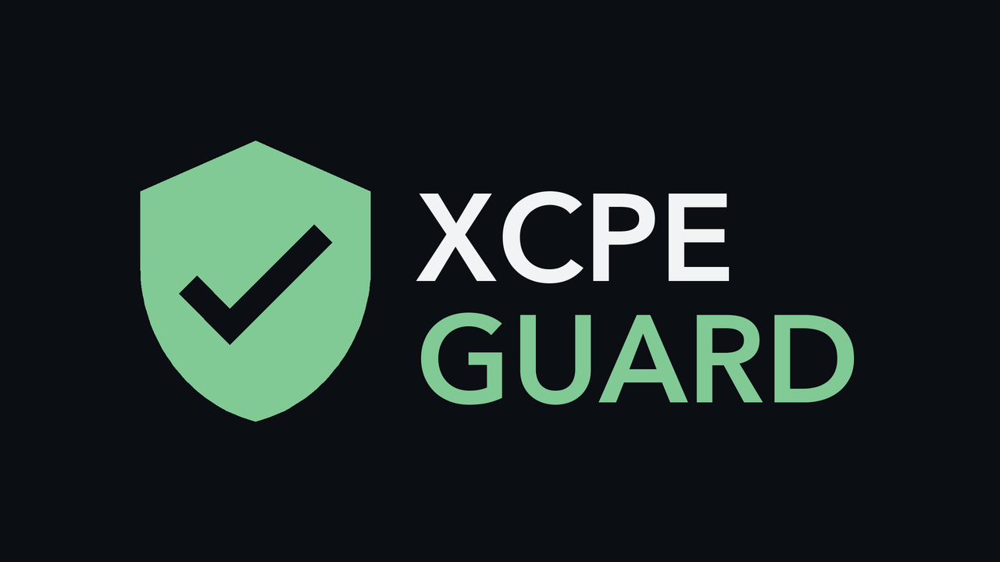
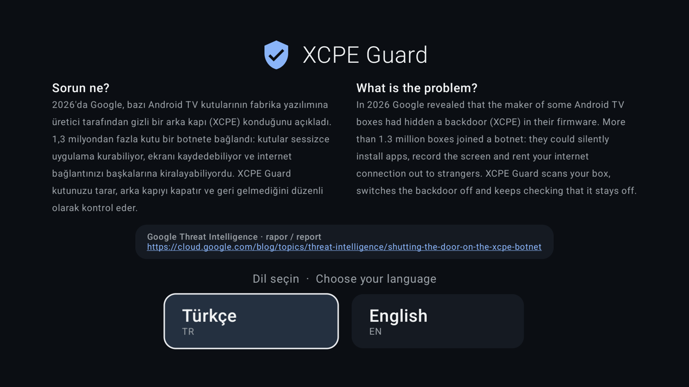
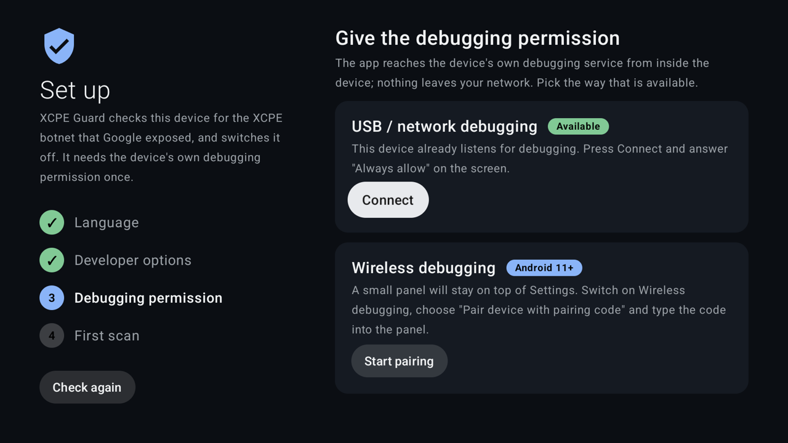
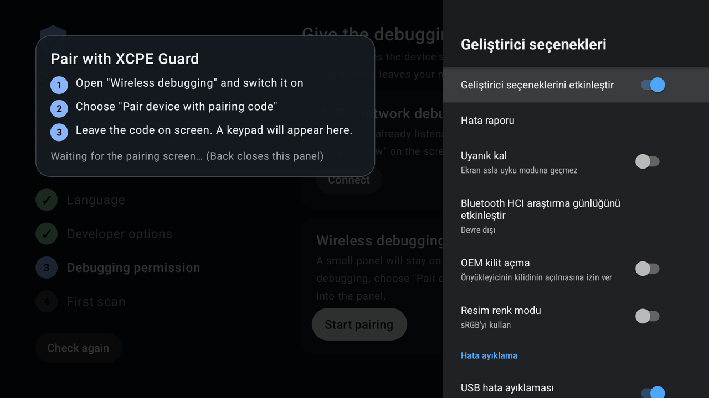
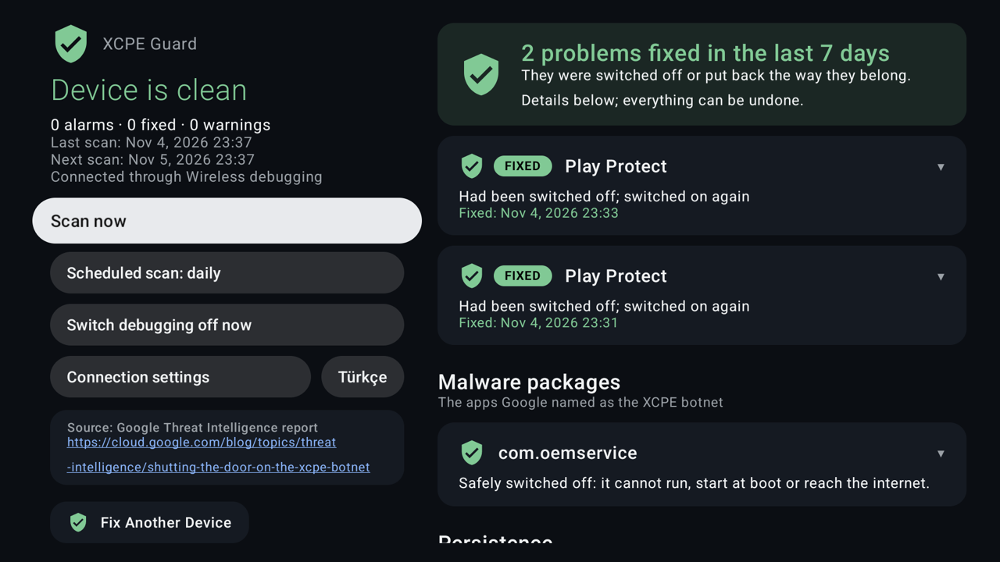
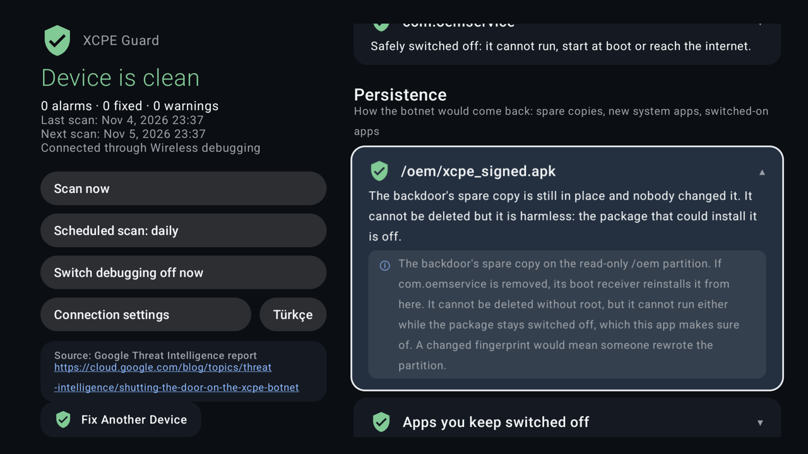
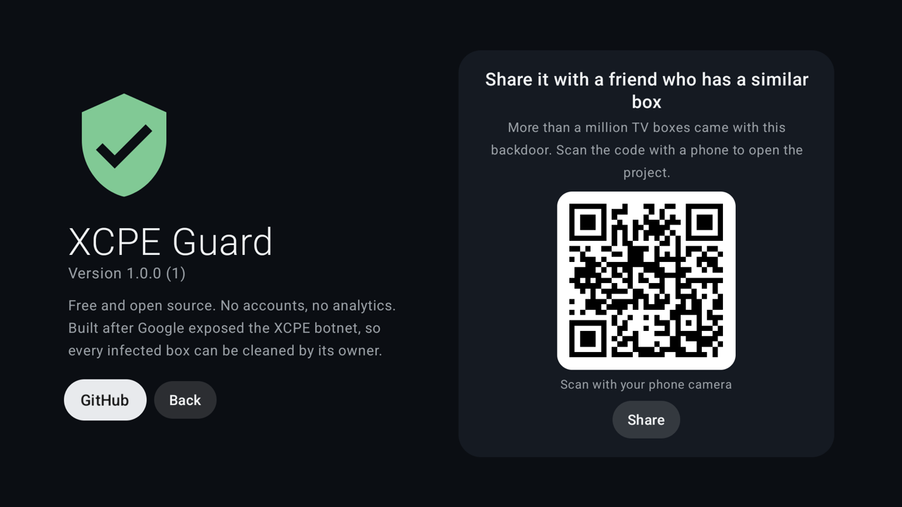

<p align="center">
  
</p>

<h1 align="center">XCPE Guard</h1>

<p align="center">
  <b>Android TV kutularındaki XCPE botnetini kutunun kendisinden bulur ve kapatır. Bilgisayar ya da root gerekmez.</b>
</p>

<p align="center">
  <a href="https://github.com/burakztrk/xcpe-guard/releases/latest"></a>
  <a href="https://github.com/burakztrk/xcpe-guard/actions/workflows/release.yml"></a>
  
  <a href="LICENSE"></a>
</p>

<p align="center">
  <a href="https://github.com/burakztrk/xcpe-guard/releases/latest/download/xcpe-guard.apk"><b>⬇ Son APK'yı indir</b></a>
  · <a href="README.md">English</a>
</p>

---

Google Threat Intelligence 2026'da
[XCPE botnet raporunu](https://cloud.google.com/blog/topics/threat-intelligence/shutting-the-door-on-the-xcpe-botnet)
yayımladı. Pek çok Android TV kutusunun üreticisi, cihazların fabrika yazılımına bir arka kapı (`x.cpe` /
`com.oemservice`) koymuştu. Bu arka kapı sistem yetkisiyle çalışıyor; sessizce uygulama kuruyor, komut çalıştırıyor,
ekranı kaydediyor, tuşlara basıyor ve internet bağlantını proxy olarak kiralıyor. **1,3 milyondan** fazla kutu botnete
katılmış.

Google sunucuları kapattı, ama arka kapı o kutuların hepsinin fabrika yazılımında duruyor. XCPE Guard kutuyu rapordaki
göstergelere göre tarar, arka kapıyı kapatır ve her gün yeniden kontrol eder.

## Ekran görüntüleri

| Dil seçimi | İzni bir kez ver |
|---|---|
|  |  |
| **Ayarlar'ın üstünde kodla eşleme** | **Sorunlar otomatik düzeltilir** |
|  |  |
| **Her satır kendini açıklar** | **Arkadaşınla paylaş** |
|  |  |

## Nasıl çalışır

Android, sahibi izin verdiğinde bir uygulamanın cihazın kendi hata ayıklama servisiyle (adbd) konuşmasına izin verir.
Botnet de bu servisi kötüye kullanmıştı; burada senin için, kutunun içinden çalışır ve ağından dışarı hiçbir şey çıkmaz.

1. **Dil**: Türkçe ya da English.
2. **Geliştirici seçenekleri**: uygulama nereye 7 kez basacağını gösterir.
3. **Hata ayıklama izni**, iki yoldan biriyle:
   - **Kablosuz hata ayıklama (Android 11+)**: uygulama Ayarlar'ın üstünde küçük bir tuş takımı tutar. "Eşleme kodu
     ile cihaz eşle"yi açıp kodu tuş takımına yazarsın; altıncı hane girilince eşleme kendiliğinden başlar.
     Bazı kutular eşleme ekranını ağda hiç duyurmaz, bu yüzden tuş takımı kendiliğinden açılamaz. Kablosuz hata
     ayıklama açıldıktan sonra panel geri sayar, ardından önce IP adresinin yanındaki portu, sonra kodu ister.
   - **USB / ağ hata ayıklama**: kutu 5555 portunda zaten dinliyorsa (bu kutuların çoğu öyle) TV bir kez
     "Hata ayıklamaya izin verilsin mi?" diye sorar.
4. İlk bağlantıdan sonra uygulama kendine `WRITE_SECURE_SETTINGS` verir. Her taramada **hata ayıklamayı açar, tarar,
   yeniden kapatır**.

Geri gelen her şey hemen kapatılır (`pm disable-user`), arka kapının erişilebilirlik kancası kaldırılır ve Play Protect
yeniden açılır. Hiçbir şey kaldırılmaz; her şey geri alınabilir.

## Neleri kontrol eder

| Alan | Kontrol |
|---|---|
| Zararlı paketler | Google'ın listelediği 10 paket: `x.cpe`, `com.oemservice`, `com.abc.nexus`, dropper'lar, proxy SDK'ları |
| Şüpheli üretici uygulamaları | `com.oem.qa`: arka kapıyla birlikte güncellenen, sessiz kurulum servisli fabrika test uygulaması |
| Kalıcılık | `/oem` APK parmak izleri (arka kapının yedek kopyası), firmware güncellemesi olmadan beliren sistem uygulamaları, yeni `/system/priv-app` klasörleri, yeni privapp izin dosyaları, `persist.networkstack.*`, zararlı yerel kütüphaneler, yeniden açılan kapalı uygulamalar |
| Ayarlar | Erişilebilirlik servisleri, Play Protect, çalışan süreçler, hata ayıklama durumu |
| Ağ | C2 adreslerine ve 3885–3887 MQTT portlarına giden canlı TCP bağlantıları, DNS'in C2 adlarını engelleyip engellemediği, ev filtresini atlayan Özel DNS |

## Tam liste: neleri kapatır

Hiçbir şey kaldırılmaz. Her paket `pm disable-user` ile kapatılır ve durdurulur; istediğin zaman geri açılabilir.

| Paket | Ne yapar |
|---|---|
| `x.cpe`, `com.oemservice` | Arka kapının kendisi: sessizce uygulama kurar, komut çalıştırır, ekranı kaydeder, tuşlara basar |
| `com.abc.nexus` | ABCNexus yükleyici: reklam dolandırıcılığı ve proxy modüllerini indirir |
| `com.vs.grass` | Google'ın ABCNexus ile aynı araç setinde listelediği paket |
| `com.android.system.ntp` | Saat servisi kılığında dropper; botneti sistem uygulaması olarak yeniden kurar |
| `com.android.sso.auth.handler` | AppSalt proxy SDK'sını kuran dropper |
| `com.ota.service` | HiddenView: arka planda reklamlara tıklar |
| `com.newtv.cboxtv` | Fission dinamik kod arka kapısı |
| `com.gaganode`, `com.gaganode.sdk` | GaGaNode / IPCola proxy: yabancıların trafiğini senin bağlantından geçirir |
| `com.oem.qa` | Üreticinin fabrika test uygulaması (BoxFactoryTest), sessiz APK kurucusu var. Google'ın listesinde yok, bu yüzden şüpheli olarak işaretlenir. Hiç başlatılmaz |

## Tam liste: başka neleri düzeltir

1. **Erişilebilirlik kancası**: arka kapının `AccessibilityKeyDetector` kaydını siler, diğer servislerine dokunmaz.
2. **Play Protect**: kapatılmışsa (`package_verifier_user_consent=-1`) yeniden açar.
3. **Özel DNS "Otomatik"**: AdGuard gibi ev DNS filtresini atlayabildiği için `off` yapar.
4. **Geri gelen ya da beliren paketler**: ilk taramada kapalı olan ve yeniden açılan paketleri, ayrıca firmware
   güncellemesi olmadan beliren yeni sistem uygulamalarını (dropper işareti) tekrar kapatır.

## Tam liste: neleri yalnızca bildirir

- **Süreçler**: `oemservice`, `x.cpe`, `abc.nexus`, `vs.grass`, `system.ntp`, `sso.auth.handler`, `gaganode`,
  `lw_android_agent`
- **Yerel kütüphaneler**: `libseccomp_guard.so`, `libexploit.so`, `libnative_keys.so`, `libfleetshare.so`,
  `libjaguar.so`, `libtraceroute.so`, `lw_android_agent`
- **Özellikler**: `persist.networkstack.uninstall`, `persist.networkstack.skip_system_install`,
  `persist.networkstack.install_time`
- **`/oem` parmak izleri**: yedek kopya `xcpe_signed.apk` ve Google'ın yedi SHA-256 değeri. Root olmadan silinemez,
  paketi kapalı kaldığı sürece zararsız
- **Sistem klasörleri**: yeni bir `/system/priv-app` klasörü ya da yeni bir `privapp-permissions` dosyası alarm verir
- **Ağ**: `219.134.163.210`, `219.134.163.211`, `23.94.49.57`, `38.145.197.135` C2 adreslerine ve 3885–3887 MQTT
  portlarına canlı TCP bağlantısı
- **DNS**: şu yedi C2 adının engellenip engellenmediği: `mqtt.szbboys.com`, `ott.szbboys.com`,
  `mcstb.anyevonline.com`, `intermedia-arts.tv`, `yokatvonline.com`, `linkfog.cn`, `hiddeninplainsight.top`
- **Yeni kullanıcı uygulamaları**: bilgi olarak bir kez listelenir
- **Firmware parmak izi**: değişirse alarm yerine yeni referans kaydedilir

Uygulamanın kendisi her taramada hata ayıklamayı açıp yeniden kapatır, günde bir kez (ve açılıştan 2 dakika sonra)
tarar; tek ağ trafiği yukarıdaki yedi adın DNS sorgusudur.

## Kurulum

1. [`xcpe-guard.apk`](https://github.com/burakztrk/xcpe-guard/releases/latest/download/xcpe-guard.apk) dosyasını indir
   ya da uygulamanın Hakkında ekranındaki QR kodu telefonla okut.
2. Kutuya yükle; örneğin Downloader uygulamasıyla ya da bir bilgisayardan:
   ```bash
   adb install xcpe-guard.apk
   ```
3. Uygulamalar satırından **XCPE Guard**'ı aç ve üç adımı izle.

Her sürümde indirmeyi doğrulamak için bir `.sha256` dosyası da bulunur.

## Derleme

JDK 17 ve Android SDK (platform 34) gerekir.

```bash
git clone https://github.com/burakztrk/xcpe-guard.git
cd xcpe-guard
./gradlew assembleDebug        # app/build/outputs/apk/debug/app-debug.apk
./gradlew assembleRelease      # app/build/outputs/apk/release/app-release.apk
```

Keystore yoksa release derlemesi yerel debug anahtarınla imzalanır. Kendi anahtarınla imzalamak için:

```bash
export KEYSTORE_FILE=/yol/release.jks
export KEYSTORE_PASSWORD=…  KEY_ALIAS=…  KEY_PASSWORD=…
export VERSION_CODE=42         # isteğe bağlı; versionCode 42, versionName 1.0.42 olur
./gradlew assembleRelease
```

### Sürümler

`main`'e her push [`.github/workflows/release.yml`](.github/workflows/release.yml) iş akışını çalıştırır: release APK'yı
derler, imzalar ve `v1.0.<çalıştırma numarası>` sürümü olarak yayımlar. Yukarıdaki indirme linki ve sürüm rozeti hep en
sonuncuyu gösterir. İş akışı dört repo secret'ı okur (Settings → Secrets and variables → Actions): `KEYSTORE_BASE64`
(keystore'un base64 hali), `KEYSTORE_PASSWORD`, `KEY_ALIAS` ve `KEY_PASSWORD`. Bunlar yoksa sürüm yayımlamaz, yalnızca
imzasız bir derleme yükler; çünkü güncellemelerin her seferinde aynı anahtarla imzalanması gerekir.

## Ağında engelle

XCPE Guard kutunun içinde çalışır. Ağındaki her cihazı botnetin sunucularından uzak tutmak için aynı Google raporundan
çıkan [AdGuard engelleme listesini](docs/adguard-blocklist.md) (154 kural) AdGuard Home'a ya da AdGuard
sözdizimini anlayan herhangi bir DNS filtresine ekle. Uygulamadaki "C2 alan adları (DNS)" satırı o zaman yeşile döner.

## Uygulama yüklemek istemiyorsan: yapay zekâ ajanı

Kutuya hiçbir şey yüklemek istemezsen, kabuk erişimi olan bir yapay zekâ ajanı aynı ağdaki bir bilgisayardan adb ile aynı
kontrolleri ve düzeltmeleri yapabilir. Güvenlik kurallarıyla birlikte adım adım yöntem
[skills/xcpe-guard/SKILL.md](skills/xcpe-guard/SKILL.md) dosyasında.

**Claude Code** (beceri olarak):

```bash
git clone --depth 1 https://github.com/burakztrk/xcpe-guard.git /tmp/xcpe-guard
mkdir -p ~/.claude/skills && cp -r /tmp/xcpe-guard/skills/xcpe-guard ~/.claude/skills/
```

Sonra şunu iste: *"192.168.1.50 adresindeki Android TV kutumu XCPE botnetine karşı kontrol et ve temizle."*

**Başka bir ajan** (Codex, Gemini CLI, Cursor…): repoyu klonlayıp ajanda aç; [AGENTS.md](AGENTS.md) onu aynı yönteme
yönlendirir. Ya da şunu yapıştır: *"https://raw.githubusercontent.com/burakztrk/xcpe-guard/main/skills/xcpe-guard/SKILL.md
dosyasını oku ve ona göre Android TV kutumu XCPE botnetine karşı kontrol et."*

`adb` ve kutuda USB ya da Kablosuz hata ayıklama açık Geliştirici seçenekleri gerekir. Ajan bulduklarını gösterir ve
herhangi bir şeyi kapatmadan önce onayını bekler. Kapatır, kaldırmaz; her şey geri alınabilir.

## Sınırlar

- **Root yok.** Arka kapının salt-okunur `/oem` bölümündeki yedek kopyası silinemez. Paketi kapalı kaldığı sürece de
  çalışamaz; uygulama bunu sağlar.
- **Fabrika ayarlarına sıfırlama** kutuyu fabrika durumuna döndürür: sonra uygulamayı yeniden çalıştır.
- **IP adresleri** root olmadan bir uygulamadan engellenemez. C2 alan adlarını router'da ya da DNS filtrende
  (AdGuard Home, Pi-hole) engelle; uygulama hâlâ çözülüp çözülmediklerini gösterir.
- Android kullanılmayan bir hata ayıklama anahtarını **7 gün** sonra unutur. Günlük tarama bunu taze tutar; otomatik
  tarama kapalıysa ya da kutu daha uzun kapalı kaldıysa uygulamayı açıp yeniden bağlan.

## Gizlilik

Hesap yok, analiz yok, kendine ait sunucu yok. Tek ağ trafiği, ağının engelleyip engellemediğini görmek için yedi C2
alan adının DNS sorgusudur.

## Teşekkürler

- Göstergeler: Google Threat Intelligence Group.
- ADB eşleme ve TLS: Muntashir Al-Islam'ın [libadb-android](https://github.com/MuntashirAkon/libadb-android)
  kütüphanesi; tüm kütüphaneler için [THIRD-PARTY-NOTICES.md](THIRD-PARTY-NOTICES.md).
- [Clean Your TV](https://github.com/Gathin23/cleanyourtv) ile yapılan bir temizlikten doğdu.

## Lisans

[GPL-3.0](LICENSE). Özgür ve açık kaynak: her amaçla kullanabilir, inceleyebilir, değiştirebilir ve paylaşabilirsin.
Değiştirilmiş bir sürümü dağıtırsan, o sürümün de aynı lisansla açık kaynak kalması gerekir.
